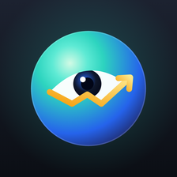
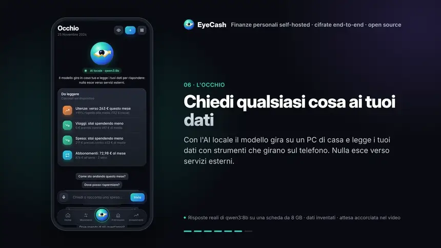
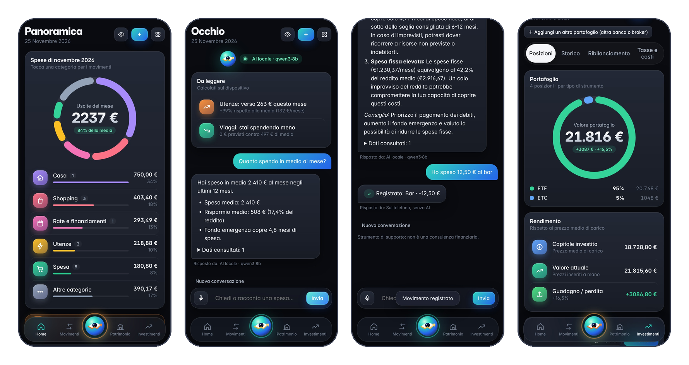
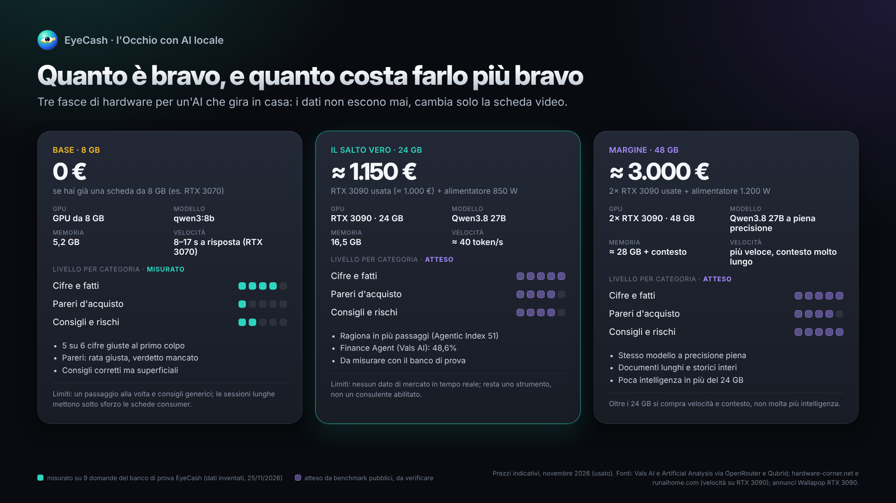

<p align="center">
  
</p>

<h1 align="center">EyeCash</h1>

<p align="center">
  <b>Vedi dove vanno i tuoi soldi, senza mostrarli a nessun altro.</b><br>
  Finanza personale self-hosted, con cifratura end-to-end e un'AI rispettosa della privacy.
</p>

<p align="center">
  <a href="README.md">🇬🇧 English</a> ·
  <a href="#avvio-rapido">Avvio rapido</a> ·
  <a href="docs/GUIDA.md">Guida completa</a> ·
  <a href="docs/AI.md">AI e modelli locali</a> ·
  <a href="docs/IMPORT.md">Importare i dati della banca</a>
</p>

<p align="center">
  <a href="docs/media/eyecash-demo-it.mp4"></a><br>
  <sub><a href="docs/media/eyecash-demo-it.mp4">▶ Guarda la demo di 65 secondi, con musica</a> · <a href="docs/media/eyecash-demo-en.mp4">English version</a> · le risposte sono vere risposte di un modello locale (qwen3:8b su una scheda da 8 GB), i dati sono di una persona inventata</sub>
</p>

---

## L'idea

I movimenti del conto dicono di te più di quasi ogni altra cosa: dove vivi, cosa mangi, chi frequenti, come stai di salute. Eppure quasi tutte le app di finanza ti chiedono di caricarli sul loro cloud.

EyeCash fa il contrario:

- **Gira a casa tua**, su un mini PC, un NAS o qualsiasi macchina Linux. Dal telefono la raggiungi con una rete privata come [Tailscale](https://tailscale.com): niente è esposto su internet.
- **I dati sono cifrati sul tuo dispositivo** con una chiave che deriva dalla tua password. Il server conserva solo dati cifrati: chi rubasse il disco o un backup non leggerebbe nulla.
- **L'AI aiuta senza vedere le tue finanze.** Trasforma *"12 euro pizza"* in una spesa, oppure scrive la *ricetta* per rispondere a *"quanto ho speso in ristoranti quest'anno?"* o a *"posso comprare l'auto l'anno prossimo?"*. I conti li fa il telefono: saldi, conti e importi non arrivano mai all'AI.
- **L'AI è facoltativa e può essere tutta locale.** Puoi usare Claude o un'API compatibile OpenAI, oppure un modello aperto con [Ollama](https://ollama.com) sul tuo server. O nessuna AI: tutto il resto funziona uguale.

**Chiedigli quello che stai per decidere:** *"Posso permettermi un mutuo da 200.000 €?"*, *"Posso comprare un'auto da 25.000 € a rate?"*. La risposta nasce dai tuoi numeri reali (entrate, abitudini di spesa, risparmi, investimenti e finanziamenti) ed è calcolata sul tuo dispositivo. L'AI, se la usi, legge solo la frase.

## Funzioni

<p align="center"></p>

**Ogni giorno**
- Conti (corrente, carte di credito, risparmio, contanti) con i saldi aggiornati.
- Inserimento veloce: importo, tocchi l'icona della categoria, fatto. Oppure scrivi o detta *"12,50 pizza carta"*.
- Movimenti giorno per giorno, spese ricorrenti, budget con quanto puoi spendere al giorno, obiettivi.
- **Importazione degli estratti conto** (CSV, Excel, vecchi .xls, PDF):
  - riconosce le colonne e ricorda il formato di ogni banca;
  - assegna le categorie in automatico;
  - riconosce i doppioni con le spese che avevi già segnato a mano;
  - gestisce le carte di credito.

  Vedi [Importare i dati della banca](docs/IMPORT.md).

**Il quadro generale**
- Patrimonio netto, con beni (auto con deprezzamento, case) e debiti (mutui con piano di ammortamento).
- Statistiche: medie mensili, tasso di risparmio, andamento per categoria, mappa delle spese.
- **Investimenti:**
  - più portafogli;
  - prezzi automatici da fonti pubbliche;
  - allocazione obiettivo e ribilanciamento;
  - regole fiscali italiane, compreso il "zainetto";
  - dividendi.
- **Storico investimenti:**
  - operazioni ricostruite dagli estratti conto;
  - valore e capitale versato nel tempo;
  - rendimento annuo (XIRR);
  - plusvalenze realizzate anno per anno.
- **Simulatore FIRE:** simulazione Monte Carlo dell'indipendenza finanziaria, con scenari di stress. Gira tutta sul dispositivo.
- **L'Occhio** (il logo al centro della barra) è un unico posto per parlare con i tuoi dati. Puoi chiedere cifre, chiedere un parere, simulare un acquisto o raccontare una spesa da registrare (*"ho speso 12 € al bar"*, poi confermi con un tocco). Sbatte le palpebre quando c'è qualcosa di nuovo da leggere. Come risponde dipende dall'AI:
  - **AI locale** (Ollama in casa): un vero agente. Il modello usa strumenti che girano sul tuo dispositivo (spese per categoria, ricerca nei movimenti, simulazione della liquidità, portafoglio…) e ne legge i risultati. Nulla esce di casa.
  - **AI esterna** (Claude, OpenAI…): alla cieca. Esce solo la domanda; l'AI risponde con una ricetta e il telefono calcola ogni numero.
  - **Senza AI o offline:** domande rapide, cifre semplici (*"quanto ho speso in ristoranti negli ultimi 6 mesi?"*), simulazioni d'acquisto e spese vengono capite sul dispositivo.
- **Consulente:** puoi chiedere un parere, non solo una cifra. Per esempio: *"Tra un mese spendo 15.000 €, il prossimo anno vorrei un PC da 3.000: conviene?"*.
  - L'AI trasforma la domanda in una ricetta: gli eventi futuri e le regole da verificare (non andare in rosso, tenere il fondo emergenza, rate sotto un terzo del reddito…).
  - Il telefono simula la liquidità mese per mese sui numeri reali e risponde *Sì / Sì, ma da marzo / No*, con i motivi e un grafico.
  - Puoi continuare con domande come *"e se lo prendo a rate?"*.

  Esce solo la domanda, mai un numero.
- **"Posso permettermelo?"** (dentro l'Occhio, con il simulatore completo a un tocco) Mutuo, auto o qualsiasi grande acquisto, simulati sulle tue entrate, spese, risparmi e rate reali. Ottieni:
  - un verdetto chiaro e la rata mensile;
  - i controlli che farebbe una banca: rate sul reddito, mutuo sul prezzo, fondo di emergenza che resta, risparmio dopo l'acquisto;
  - il prezzo massimo che li supera tutti e tra quanto avresti i soldi;
  - la liquidità dei prossimi 3 anni.

  Puoi chiederlo a parole, con o senza AI.
- **Report per te o per il tuo consulente** (mese, anno o ultimi 12 mesi, stampabili in PDF), con gli indicatori che guarda un consulente finanziario:
  - tasso di risparmio e fondo di emergenza in mesi;
  - spese fisse e rate rispetto al reddito;
  - la **rata aggiuntiva che puoi sostenere** (una prima risposta a *"posso permettermi questo mutuo?"*);
  - debiti sul patrimonio, rendimento e costi degli investimenti.

  La modalità *solo sintesi* toglie esercenti e singoli movimenti, per condividerlo.

**Privacy e comodità**
- Cifratura end-to-end, password mai inviata al server, backup giornalieri cifrati, e backup cifrati che puoi scaricare dall'app.
- Sblocco con Face ID, Touch ID o Windows Hello, blocco automatico dopo il tempo che scegli, saldi oscurati e contenuto nascosto nel multitasking del telefono.
- Funziona **offline**: sul dispositivo resta una copia cifrata, e le modifiche si sincronizzano al ritorno della rete.
- Si installa come app su **iPhone, Android e computer** (PWA). Tema chiaro e scuro, interfaccia in **italiano e inglese**.
- Spese aggiunte da **Claude Desktop** o da qualsiasi client MCP. L'accesso MCP è *solo in scrittura*: può aggiungere, mai leggere.
- **Zero dipendenze:** solo i moduli integrati di Node.js e il browser.

## Come sono protetti i dati

- La password viene trasformata con **PBKDF2-SHA256 (600.000 iterazioni)** in due chiavi:
  - una serve a farti riconoscere dal server, che ne conserva solo un hash scrypt;
  - l'altra cifra i dati (AES-256-GCM) e non lascia mai il dispositivo.
- I dati cifrati sono arrotondati a blocchi di 16 KB, così nemmeno la loro dimensione rivela ogni modifica.
- Ogni funzione AI ha il suo interruttore in *Impostazioni → Privacy*, e ogni invio viene registrato: vedi esattamente cosa è uscito.
- Il container gira in sola lettura e senza privilegi, e ascolta solo su `127.0.0.1`.

I dettagli sono in [ARCHITECTURE.md](docs/ARCHITECTURE.md) (in inglese) e in [SECURITY.md](SECURITY.md).

## Avvio rapido

Ti serve una macchina Linux sempre accesa con **Docker**: va bene un mini PC, un server di casa o un NAS che esegue container.

```bash
git clone https://github.com/CrisBilli/eyecash.git
cd eyecash
bash install.sh
```

Poi:

1. **Raggiungila dal telefono** con Tailscale: lancia `sudo tailscale serve --bg 8080` e apri l'indirizzo `https://<server>.<tailnet>.ts.net` che ti mostra.
2. **Crea la password** nell'app. Cifra i tuoi dati: salvala in un password manager, perché se la perdi nessuno può recuperarli.
3. **Installa l'app sul telefono:**
   - iPhone: Safari → Condividi → *Aggiungi alla schermata Home*;
   - Android e computer: Chrome → *Installa app*.
4. **AI facoltativa:** con `bash setup-ai.sh` scegli un modello locale (Ollama) o un'API cloud.

Per aggiornare basta `bash update.sh`: fa una copia di sicurezza del database, scarica la nuova versione, ricostruisce l'app e verifica che risponda.

La guida passo passo completa è in [docs/GUIDA.md](docs/GUIDA.md): firewall, Tailscale, backup, MCP, manutenzione.

## Un'AI privata in casa: cosa sa fare, quanto costa

Con un modello locale l'Occhio è un piccolo agente: legge i tuoi dati con strumenti che girano sul telefono, e il modello gira su un PC di casa. **Niente va a servizi esterni**, e quando il PC è spento il telefono risponde comunque a cifre e simulazioni e mette in coda il resto.

<p align="center"></p>

Quanto è brava? Nel repository c'è un **banco di prova di 104 domande** su una persona inventata ([`bench/`](bench/README.md)), per misurare da soli qualsiasi modello. Il nostro primo giro di `qwen3:8b` su una scheda da 8 GB, su un campione di 9 domande:

- **Cifre e fatti:** 5 giuste su 6, in 8–17 secondi ciascuna.
- **Pareri sugli acquisti:** calcola la rata giusta, ma spesso si ferma lì e chiede dati che potrebbe leggere da solo.
- **Consigli e rischi:** corretti ma poco approfonditi, di solito basati su un solo strumento.

I livelli delle fasce da 24 e 48 GB sono **attesi, non misurati**: vengono dai benchmark pubblici di Qwen3.8 27B (fonti in fondo all'immagine). I prezzi sono stime di novembre 2026, schede usate comprese. In breve: per le cifre basta una scheda da 8 GB che magari hai già; con una 24 GB usata (circa 1.150 € con l'alimentatore) pareri e consigli diventano davvero utili; oltre, si compra soprattutto velocità e contesto più lungo, non molta più intelligenza.

## AI: cloud o locale, sempre facoltativa

| Opzione | I dati escono dalla tua rete? | Note |
|---|---|---|
| Nessuna AI | Mai | Funziona tutto tranne gli aiuti AI |
| **Ollama** (locale) | **Mai** | `AI_PROVIDER=ollama`, nessuna chiave. `docker compose --profile ollama up -d` lo avvia per te |
| LM Studio, llama.cpp, vLLM (locali) | Mai | `AI_PROVIDER=local` + `OPENAI_BASE_URL` |
| Anthropic Claude | Solo ciò che ogni interruttore consente | Qualità migliore, legge anche gli estratti conto in PDF |
| API compatibili OpenAI | Solo ciò che ogni interruttore consente | OpenAI, OpenRouter, Mistral, Groq… |

Cosa invia ogni funzione e quali modelli locali usare: [docs/AI.md](docs/AI.md).

## Importare i dati della banca

EyeCash è stata provata con gli export di **Fineco**:
- movimenti del conto e delle carte (Excel);
- *Portafoglio di sintesi* (.xls);
- *Movimenti Dossier Titoli* (Excel).

Le altre banche funzionano con l'importazione generica, che riconosce i nomi di colonna più comuni (data, descrizione, importo oppure addebiti/accrediti, in italiano o in inglese). Se un formato non viene riconosciuto, l'AI facoltativa lo impara una volta guardando poche righe con gli importi mascherati, e il formato viene ricordato. Dettagli in [docs/IMPORT.md](docs/IMPORT.md).

## Roadmap

- [x] Report di salute finanziaria con la rata aggiuntiva sostenibile
- [x] **"Posso permettermelo?"**: mutuo, auto, grandi acquisti, simulati sulle tue entrate, spese e risparmi reali
- [ ] Modalità famiglia: account cifrati separati sullo stesso server, con spazi condivisi facoltativi
- [x] Interfaccia in italiano e in inglese, con cambio lingua nell'app
- [ ] Altre lingue
- [ ] Formati pronti per altre banche
- [ ] Versione nativa facoltativa (widget, notifiche)

Idee e proposte sono benvenute nelle [Issues](https://github.com/CrisBilli/eyecash/issues).

## Licenza e crediti

EyeCash è software libero con licenza **[Apache 2.0](LICENSE)**. Puoi usarlo, modificarlo e ridistribuirlo, anche a scopo commerciale, a patto di mantenere il file **[NOTICE](NOTICE)** con il credito all'autore e di mostrarlo dove il tuo prodotto mostra le note di terze parti. Il nome **EyeCash** e il logo non sono concessi in licenza: un prodotto derivato deve avere un nome proprio, e può dire di essere *basato su EyeCash*.

Creata da **[0xCris](https://github.com/CrisBilli)**.
