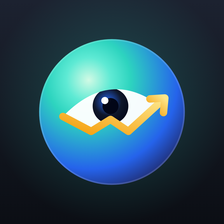
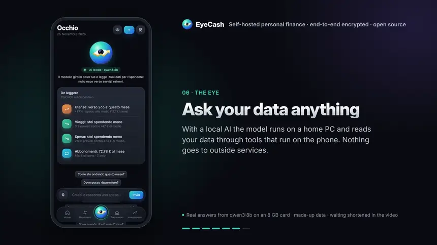
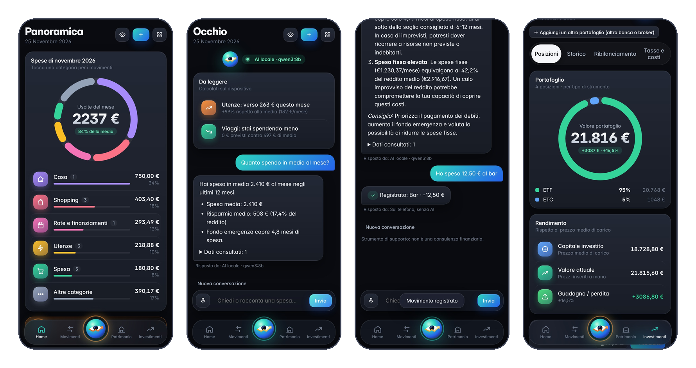
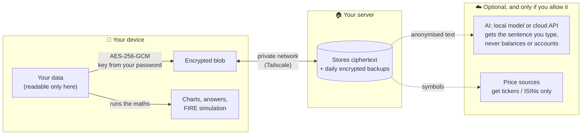
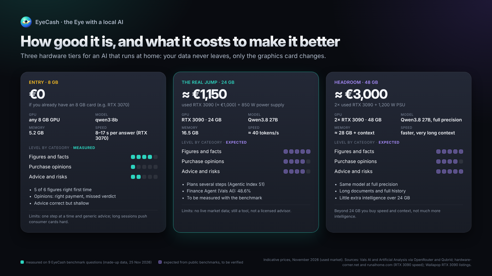

<p align="center">
  
</p>

<h1 align="center">EyeCash</h1>

<p align="center">
  <b>See where your money goes, without showing it to anyone else.</b><br>
  Self-hosted personal finance with end-to-end encryption and privacy-first AI.
</p>

<p align="center">
  <a href="LICENSE"></a>
  
  
  
  
</p>

<p align="center">
  <a href="README.it.md">🇮🇹 Leggi in italiano</a> ·
  <a href="#quick-start">Quick start</a> ·
  <a href="docs/ARCHITECTURE.md">Architecture</a> ·
  <a href="docs/AI.md">AI &amp; local models</a> ·
  <a href="docs/IMPORT.md">Importing bank data</a>
</p>

<p align="center">
  <a href="docs/media/eyecash-demo-en.mp4"></a><br>
  <sub><a href="docs/media/eyecash-demo-en.mp4">▶ Watch the 70-second demo</a> · <a href="docs/media/eyecash-demo-it.mp4">versione italiana</a> · the answers are real answers of a local model (qwen3:8b on an 8 GB graphics card), the data is a made-up person</sub>
</p>

---

## The idea

Your bank transactions say more about you than almost anything else: where you live, what you eat, who you see, how healthy you are. Yet most finance apps ask you to upload all of it to their cloud.

EyeCash turns that around:

- **It runs at home.** On a mini PC, a NAS or any Linux machine. You reach it from your phone through a private network such as [Tailscale](https://tailscale.com). Nothing is exposed to the internet.
- **Your data is encrypted on your device** with a key derived from your password. The server only ever stores ciphertext. Whoever steals the disk or a backup reads nothing.
- **The AI helps without seeing your finances.** It can turn "12 euro pizza" into an expense, or write the *recipe* for answering "how much did I spend on restaurants this year?" or "can I buy a car next year?". The numbers are computed on your phone, so balances, accounts and amounts never reach the AI.
- **AI is optional, and can be fully local.** Use Claude or any OpenAI-compatible API, or run an open model with [Ollama](https://ollama.com) on your own server. Or use no AI at all: everything else works the same.

**Ask it what you are about to decide:** *"Can I afford a €200,000 mortgage?"*, *"Can I buy a €25,000 car in instalments?"*. The answer comes from your real numbers (income, spending habits, savings, investments and loans) and is computed on your device. The AI, if you use it, only reads the sentence.

## Features

<p align="center"></p>
<p align="center"><sub>Screens shown in Italian · the English interface is one switch away in Settings</sub></p>

**Everyday money**
- Accounts (current, credit cards, savings, cash) with live balances.
- Fast entry: amount, tap a category icon, done. Or type/dictate *"12,50 pizza carta"*.
- Day-by-day transactions, recurring payments, budgets with a daily allowance ("you can spend €52.90 a day"), goals.
- **Bank statement import** (CSV, Excel, old .xls, PDF): automatic column detection, formats remembered per bank, automatic categories, duplicate detection against what you typed by hand, credit-card handling. See [Importing bank data](docs/IMPORT.md).

**The bigger picture**
- Net worth with assets (cars with depreciation, homes) and debts (mortgages with amortisation).
- Statistics: monthly averages, saving rate, category trends, spending heatmap.
- **Investments:** multiple portfolios, automatic prices from public sources, target allocation and rebalancing, Italian tax rules, dividends.
- **Investment history:** trades rebuilt from your statements, value vs money invested over time, annual return (XIRR), realised gains per year.
- **FIRE simulator:** a Monte Carlo simulation of financial independence with stress scenarios. It runs entirely on your device.
- **The Eye** (the logo in the middle of the bar) is one place to talk with your data. You can ask for figures, ask for an opinion, simulate a purchase, or tell it an expense to record (*"spent €12 at the bar"*, then confirm with a tap). It also blinks when there is something new to read. How it answers depends on your AI:
  - **Local AI** (Ollama at home): a real agent. The model calls tools that run on your device (spending by category, transaction search, cash simulation, portfolio…) and reads their results. Nothing leaves your home.
  - **External AI** (Claude, OpenAI…): blind. Only the question leaves; the AI answers with a recipe and your phone computes every number.
  - **No AI or offline:** quick questions, simple figures (*"how much on restaurants in the last 6 months?"*), purchase simulations and expenses are understood on the device.
- **Advisor** (inside the Eye): ask for an opinion, not just a figure. Example: *"Next month I'll spend €15,000, next year I'd like a €3,000 PC: is it a good idea?"*. The AI turns the question into a recipe: the future events and the rules to check (stay out of the red, keep the emergency fund, payments under a third of income…). Your phone then simulates your cash month by month on the real numbers and answers *Yes / Yes, but from March / No*, with the reasons and a chart. Follow-ups work too (*"what if I pay in instalments?"*). Only the question leaves, never a number.
- **"Can I afford it?"** (inside the Eye, with a full simulator a tap away) A mortgage, a car or any big purchase simulated on your real income, spending, savings and current loans. You get a clear verdict, the monthly payment, the checks a bank would make (payments on income, loan to price, emergency fund left, saving afterwards), the highest price that passes, how long until you would have the money, and your cash over the next 3 years. Ask in plain words, with or without AI.
- **Reports for you or your advisor** (month, year or last 12 months, print or PDF), with the indicators a financial planner looks at: saving rate, emergency fund in months, fixed costs and loan payments on income, the **extra monthly payment you can sustain** (a first answer to *"can I afford this mortgage?"*), debts on assets, investment return and costs. A *summary only* mode leaves out merchants and single transactions, for sharing.

**Privacy & comfort**
- End-to-end encryption, password never sent to the server, daily encrypted backups, and encrypted backups you can download from the app.
- Face ID / Touch ID / Windows Hello unlock, auto-lock after the time you choose, masked balances, and content hidden in the phone's app switcher.
- Works **offline**: an encrypted copy stays on the device and changes sync when you are back online.
- Installable as an app on **iPhone, Android and desktop** (PWA), with light and dark themes.
- Add expenses from **Claude Desktop** or any MCP client. The MCP endpoint is *write-only*: it can add, never read.
- **Zero runtime dependencies:** only Node.js built-ins and the browser.

> The interface is available in **English and Italian** (it follows the phone's language, and can be changed in Settings). More languages are welcome: see [CONTRIBUTING](CONTRIBUTING.md#translations).

## How your data is protected



- The password is stretched with **PBKDF2-SHA256 (600,000 iterations)** into two keys. One proves who you are to the server (stored as a scrypt hash). The other encrypts your data and never leaves the device.
- The encrypted data is padded to 16 KB blocks, so even its size does not reveal each change.
- Each AI feature has its own switch in *Settings → Privacy*, and every request is logged so you can see exactly what was sent.
- The container runs read-only, without privileges, and listens on `127.0.0.1` only.

More in [ARCHITECTURE.md](docs/ARCHITECTURE.md) and [SECURITY.md](SECURITY.md).

## Quick start

You need an always-on Linux machine with **Docker** (a mini PC, a home server or a NAS that runs containers).

```bash
git clone https://github.com/CrisBilli/eyecash.git
cd eyecash
bash install.sh
```

Then:

1. **Reach it from your phone** with Tailscale: `sudo tailscale serve --bg 8080`, and open the `https://<server>.<tailnet>.ts.net` address it prints.
2. **Create your password** in the app. It encrypts your data, so keep it in a password manager: if you lose it, nobody can recover the data.
3. **Install it** on your phone: Safari → Share → *Add to Home Screen* (iPhone), or Chrome → *Install app* (Android, desktop).
4. **Optional AI:** `bash setup-ai.sh` lets you choose a local model (Ollama) or a cloud API.

Updating later is just `bash update.sh`: it backs up the database, pulls the new version, rebuilds and checks the app is up.

<details>
<summary>Without Docker</summary>

EyeCash has no dependencies: with **Node.js 22.5+** you can run it directly.

```bash
cp .env.example .env   # optional settings
node server.js         # listens on 127.0.0.1:8080, data in ./data
```
</details>

The full step-by-step guide (in Italian) is in [docs/GUIDA.md](docs/GUIDA.md): firewall, Tailscale, backups, MCP, maintenance.

## A private AI at home: what it can do, what it costs

With a local model the Eye is a small agent: it reads your data through tools that run on your phone, and the model runs on a PC in your home. **Nothing goes to outside services**, and when the PC is off the phone still answers figures and simulations and queues the rest.

<p align="center"></p>

How good is it? The repository includes a **test bench of 104 questions** about a made-up person ([`bench/`](bench/README.md)), so you can measure any model yourself. Our first run of `qwen3:8b` on an 8 GB card, on a sample of 9 questions:

- **Figures and facts:** 5 of 6 right, in 8–17 seconds each.
- **Purchase opinions:** it computes the right payment, but often stops there and asks for data it could read itself.
- **Advice and risks:** correct but shallow, usually based on a single tool.

The levels for the 24 GB and 48 GB tiers are **expected, not measured**: they come from public benchmarks of Qwen3.8 27B (sources at the bottom of the image). Prices are November 2026 estimates, used cards included. The short version: an 8 GB card you may already own is enough for figures; a used 24 GB card (about €1,150 with power supply) is where opinions and advice become genuinely useful; beyond that you mostly buy speed and longer context, not much more intelligence.

## AI: cloud or local, always optional

| Option | Data leaves your network? | Notes |
|---|---|---|
| No AI | Never | Everything works except the AI helpers |
| **Ollama** (local) | **Never** | `AI_PROVIDER=ollama`, no key. `docker compose --profile ollama up -d` starts it for you |
| LM Studio, llama.cpp, vLLM (local) | Never | `AI_PROVIDER=local` + `OPENAI_BASE_URL` |
| Anthropic Claude | Only what each switch allows | Best quality, can also read PDF statements |
| OpenAI-compatible APIs | Only what each switch allows | OpenAI, OpenRouter, Mistral, Groq… |

What each feature sends, recommended local models and setup details: [docs/AI.md](docs/AI.md).

## Importing your bank data

EyeCash has been tested with the exports of the Italian bank **Fineco**: current account and card transactions (Excel), *Portafoglio di sintesi* (portfolio snapshot, .xls) and *Movimenti Dossier Titoli* (securities movements, Excel). Other banks work through the generic importer. It recognises common column names (date, description, amount or debit/credit, in Italian or English). When a layout is not recognised, the optional AI learns it once from a few rows with the amounts masked, and the format is remembered for the next imports.

Details, supported formats and how to add a preset for your bank: [docs/IMPORT.md](docs/IMPORT.md).

## Project structure

```
public/            the web app (no build step)
  js/              client code, one file per topic (see docs/ARCHITECTURE.md)
  engine.js        pure calculation engine shared with the server and unit-tested
server.js          server entry point
server/            server modules: api, auth & http, ai, quotes, imports, mcp…
mcp/               MCP bridge for Claude Desktop
tests/             API, engine and browser tests
docs/              documentation and media
```

## Development

```bash
node server.js                                                  # run locally
node --test tests/engine.test.js tests/api.test.js tests/local-ai.test.js
```

There are about 95 server and engine tests (no dependencies), about 230 end-to-end checks in the browser (Python + Playwright, `bash tests/run-all.sh`) and a lint pass (`node tools/lint.js`). See [CONTRIBUTING.md](CONTRIBUTING.md).

## Roadmap

- [x] Financial-health report with the sustainable extra monthly payment
- [x] **"Can I afford it?" planner**: mortgage, car, big purchases, simulated against your real income, spending and savings
- [ ] Family mode: separate encrypted accounts on the same server, with optional shared spaces
- [x] English and Italian interface with an in-app language switch
- [ ] More languages
- [ ] Import presets for more banks
- [ ] Optional native wrapper (widgets, notifications)

Ideas and votes welcome in [Issues](https://github.com/CrisBilli/eyecash/issues).

## License and credit

EyeCash is free software under the **[Apache License 2.0](LICENSE)**. You may use, modify and redistribute it, also commercially, as long as you keep the **[NOTICE](NOTICE)** file crediting the author and show it where your product shows third-party notices. The **EyeCash** name and logo are not licensed: a derived product must use its own name, and may say it is *based on EyeCash*.

Created by **[0xCris](https://github.com/CrisBilli)**.
