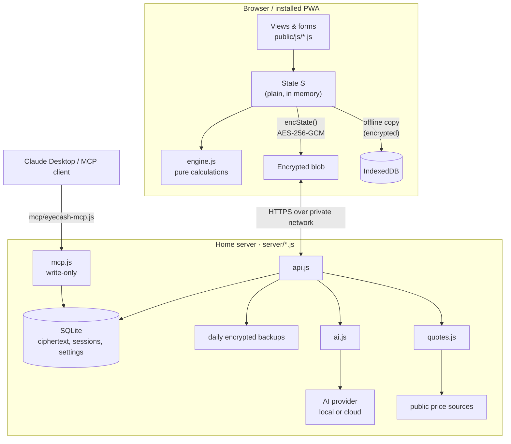

# EyeCash architecture

This document explains how EyeCash is put together and why. It is meant for contributors and for anyone who wants to check the privacy claims before trusting the app with their data.

## Principles

1. **The server must not be able to read your finances.** All data is encrypted in the browser before upload. A stolen server, disk or backup reveals nothing without the password.
2. **Computation happens on the device.** Balances, statistics, FIRE simulations and the answers to "Ask your data" are computed in the browser, on decrypted data that never leaves it.
3. **The AI is an optional helper, not a data processor.** It receives the minimum needed for one task (the sentence you type, masked sample rows of a new bank format…), never your balances, accounts or history.
4. **Zero runtime dependencies.** The server uses only Node.js built-ins (`node:http`, `node:sqlite`, `node:crypto`, `node:zlib`). The client uses only the browser. Nothing to audit beyond this repository, no supply chain to compromise.
5. **No build step.** What is in `public/` is what runs in the browser.

## Overview

## Encryption and login

| Step | What happens |
|---|---|
| Key derivation | `PBKDF2-SHA256`, 600,000 iterations, per-installation salt. The 64 derived bytes are split in two. |
| Login key | The first 32 bytes, as hex, are sent to the server. The server stores only `scrypt(loginKey, salt)`, so it never sees the password. |
| Data key | The last 32 bytes become a **non-extractable** AES-256-GCM `CryptoKey`. It is never sent anywhere. |
| Storage | The whole state is serialised, padded with spaces to a multiple of 16 KB (so the size reveals only a rough bucket) and encrypted with a random 96-bit IV per save. The server stores `{iv, ct}`. |
| "Remember this device" | The non-extractable key is kept in IndexedDB, so it cannot be read out by scripts. |
| Biometric unlock | WebAuthn (Face ID / Touch ID / Windows Hello) gates access to the remembered key on this device. |
| Session | HttpOnly, `SameSite=Strict` cookie; CSRF protection via a mandatory custom header plus `Sec-Fetch-Site`; login rate limiting. |

There is no password reset by design: whoever could reset it could read the data.

### On the device

- **Auto-lock:** after the time chosen in Settings (never, 1, 5, 15 or 60 minutes away from the app) the key is dropped from memory. With biometrics it is a soft lock (Face ID to come back), otherwise the password is needed.
- **App-switcher curtain:** while the page is hidden, its content is blurred, so the phone's app switcher, screen recordings and screen sharing never show balances.
- **Masked balances:** amounts stay blurred until revealed with Face ID or the password.
- **Encrypted backups:** *Scarica backup cifrato* downloads the same encrypted format as the server's daily backups. *Ripristina* decrypts it on the device, so a readable export is never needed.

## Sync and conflicts

The state is a single encrypted document with a version number.

1. `save()` marks the state dirty; `flush()` uploads it with the version it was based on.
2. If another device saved in the meantime, the server answers `409` with the current version.
3. The client downloads that version, decrypts it and runs `mergeStates(base, remote, local)`: a **three-way merge by record id** (transactions, accounts, holdings, trades…), so edits made on two devices are both kept and deletions are respected.
4. The server keeps the last 200 versions and a daily backup for 90 days, all encrypted.

A single document keeps the server simple and blind. It comfortably handles years of personal transactions. Very large datasets or multi-user households will need per-record storage (see the roadmap).

## Offline mode

`public/sw.js` caches the app shell (never `/api` or `/mcp`). The latest encrypted state is also kept in IndexedDB. Without network the app unlocks with the remembered key, with biometrics, or with the password verified against the local copy. New entries are queued and synced on reconnect through the normal merge.

## AI without exposing your data

Every AI call goes through `server/ai.js`. Before anything is sent, `server/text.js` masks IBANs, card numbers and long digit sequences. Each feature has a privacy switch on the client and is written to a log you can inspect.

**"Ask your data"** is the most interesting case:

1. The device sends only the **question**, the **category names** and **account aliases** (`conto_1 (Conto)`), never names, amounts or merchants.
2. The AI answers with a *recipe* in a small closed language: which source, measure, period, grouping and filters to use, plus an answer template with placeholders such as `{a.top}`.
3. The server validates and sanitises the recipe (`EN.sanitizeSpec`); anything outside the language is dropped.
4. The device runs the recipe on the real data (`EN.runQuery`) and fills the template (`EN.renderAnswer`).

The AI never sees a single number, so even a cloud model learns only that you asked "how much did I spend on restaurants this year?".

**"Can I afford it?"** works the same way. The sentence goes to `/api/ai/afford`, which returns only the purchase parameters, checked by `EN.sanitizeAfford`. Without AI, `EN.parseAffordText` understands the common phrasings on the device. `EN.affordability` then runs the checks on the real numbers locally.

**Local models** (Ollama, LM Studio, llama.cpp, vLLM) use the same OpenAI-compatible path; with `AI_PROVIDER=ollama|local` nothing leaves your network at all. See [AI.md](AI.md).

## Prices without exposing your portfolio

`server/quotes.js` asks public sources (Yahoo Finance, justETF, Stooq, Kraken, CoinGecko, ECB exchange rates) for **symbols or ISINs only**, never quantities or values. Each batch is mixed with a few **decoy** requests for popular instruments whose results are discarded, so a source cannot tell exactly what you hold. Prices are cross-checked between sources, and stale or inconsistent ones are flagged.

## MCP: write-only by design

`server/mcp.js` exposes tools to *add* an expense and to list categories, nothing that reads data. Entries are encrypted with the app's **RSA-OAEP public key** before being stored in an inbox. Only the app, holding the private key inside the encrypted state, can decrypt them. Tokens can be revoked from Settings.

## Code map

### Client (`public/`)

Plain scripts loaded in this order by `index.html`. They share the global scope, so a file may use anything defined in earlier files, and functions from later files at run time.

| File | Responsibility |
|---|---|
| `engine.js` | Pure calculations shared with the server and unit-tested: trade book (weighted average cost), XIRR, history series, trade matching, the "Ask your data" query language, financial-health indicators, the "Can I afford it?" calculation and question parser |
| `js/i18n.js` | Language, locale-aware formats, translator (`t()` and the page observer) |
| `js/i18n-en.js` | English dictionary |
| `js/core.js` | Formatting, dates, ids, category lists |
| `js/ui.js` | Theme, icons, navigation, SVG chart helpers |
| `js/state.js` | The state `S`, empty and demo states, recurring items |
| `js/sync.js` | `api()`, key derivation, encryption, save/pull, three-way merge |
| `js/lock.js` | Lock screen, biometric unlock, masked balances |
| `js/finance.js` | Balances, monthly totals, assets, debts, forecast, insights |
| `js/fire.js` | Monte Carlo FIRE simulator |
| `js/afford.js` | "Can I afford it?" planner: inputs, verdict, checks, cash projection, questions in plain words |
| `js/quotes.js` | Price refresh and listing search |
| `js/invest.js` | Portfolios, target allocation, rebalancing, taxes |
| `js/history.js` | Trades, matching, price history, investment history view |
| `js/views.js` | Home, transactions, statistics; `render()` and `go()` |
| `js/settings.js` | Settings (built from small card functions), privacy switches, MCP setup |
| `js/report.js` | Printable report: periods, financial-health indicators, net worth, categories, investments |
| `js/ai.js` | Quick entry, MCP inbox, "Ask your data" |
| `js/forms.js` | Bottom-sheet form engine and entity forms |
| `js/import.js` | Bank statement and portfolio import, categorisation, dedupe |
| `js/offline.js` | Offline copy and reconnection |
| `js/events.js` | Delegated event handlers (`data-act` attributes) |
| `js/main.js` | Start-up |

**Conventions.** Views are functions returning HTML strings (`vHome()`, `vTx()`…), composed from small helpers (`settingRow()`, `segmented()`, the `rep*()` sections of the report). Every user-provided value is passed through `esc()`; the strict Content-Security-Policy (`script-src 'self'`, no inline scripts) is a second line of defence. Buttons declare an action with `data-act="name"`; `events.js` runs `ACTIONS[name]({ el, id, e, a })` from a single table.

**Financial-health indicators.** `EN.healthIndicators()` takes plain numbers (monthly income and spending, cash, debts, recurring costs, loan payments, fund costs…) and returns each indicator with its value, a status (`good`, `warn`, `crit`, `info`) and the rule of thumb it is compared with. Being pure, it is unit-tested and could be reused by any other front end.

### Server (`server/`)

| Module | Responsibility |
|---|---|
| `config.js` | Environment variables and constants |
| `db.js` | SQLite schema and settings helpers |
| `cli.js` | `reset` and `restore` commands |
| `http.js` | Security headers, JSON, body limits, sessions, CSRF, rate limiting |
| `backup.js` | Daily encrypted backup |
| `sheets.js` | Zero-dependency readers for .xlsx and legacy .xls (BIFF8) |
| `text.js` | Shared categories, anonymisation, tolerant JSON parsing |
| `mcp.js` | Write-only MCP endpoint |
| `quotes.js` | Price sources, ECB rates, decoys, history |
| `ai.js` | AI provider abstraction (Anthropic, OpenAI-compatible, Ollama, local) |
| `estimate.js` | Optional AI estimate of car and home values |
| `static.js` | Static files |
| `api.js` | REST API routes |

The database file is still called `pointofcash.db`, and the CSRF header `X-PointofCash`, after the project's original name. They are internal and kept for compatibility with existing installations.

## Languages

The interface is written in Italian and translated at display time. `public/js/i18n.js` picks the language (saved preference, else the phone's language) and sets the locale for currency, numbers and month names. When English is active, a `MutationObserver` translates every text node and user-facing attribute added to the page using `public/js/i18n-en.js` (Italian → English, with `{placeholders}` for dynamic texts and generic separators such as `{0} · {1}`). Stored values, for example category names, never change, so data is the same in both languages and switching is instant and safe. Code that composes sentences uses `t()` with named placeholders. Answers of "Ask your data" are written by the AI directly in the chosen language.

## Tests

| Suite | What it covers |
|---|---|
| `tests/engine.test.js` | Calculation engine: tax lots, XIRR, query language |
| `tests/api.test.js` | Every API route, security headers, CSRF, rate limiting, imports, anonymisation, MCP, quotes (with mocked sources), backup/restore, stress |
| `tests/local-ai.test.js` | Ollama provider: no key, right endpoint and model |
| `tests/e2e_*.py` | Browser end-to-end with Playwright: setup, entry, import, statistics, investments, FIRE, offline mode, privacy features, report |
| `tools/lint.js` | ESLint: undefined names, unused and unreachable code, over the whole code base |

`bash tests/run-all.sh` runs everything. The Node suites need nothing but Node.js. The browser suites need Python, Playwright and Chrome, plus the two mock servers in `tests/` (fake AI and fake price sources), so they never call real services.
